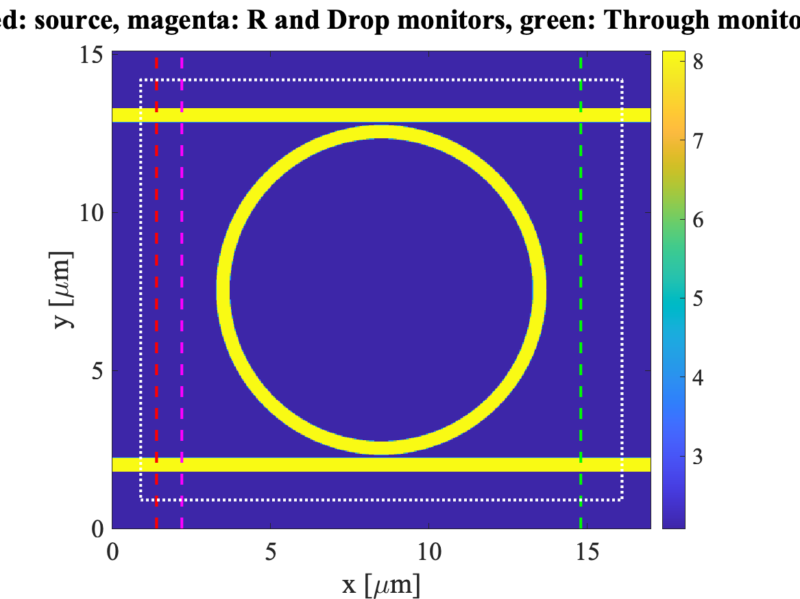
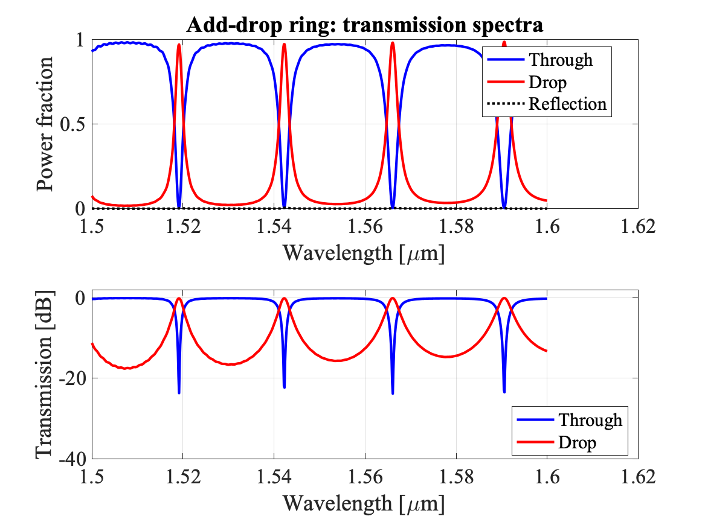
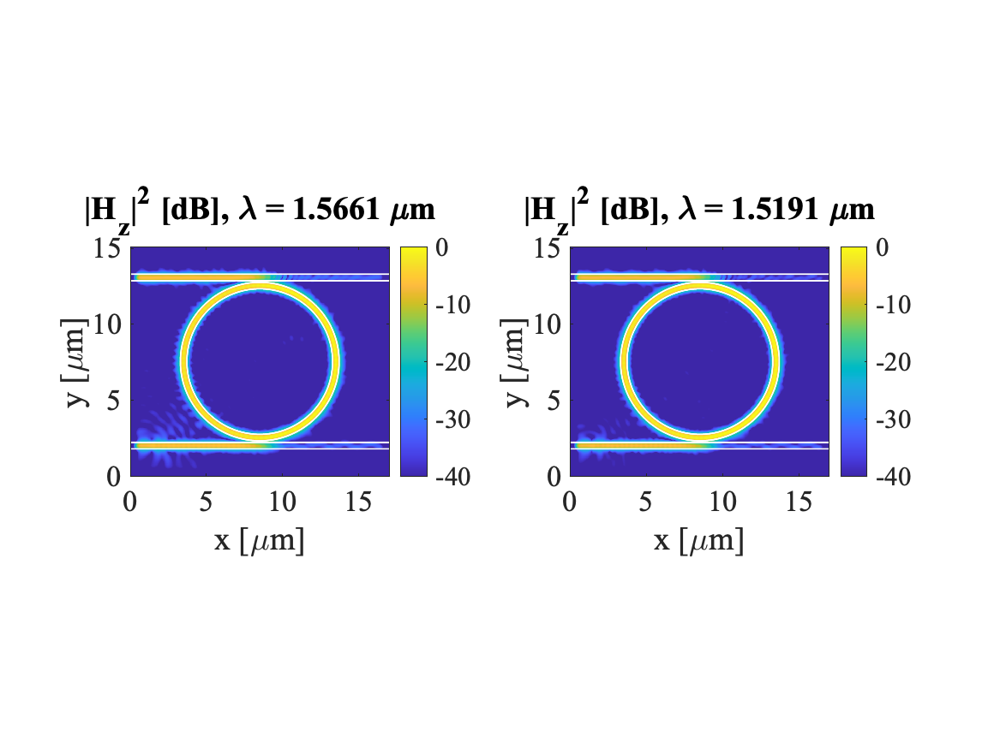

# 2D FDTD Simulation of an Add-Drop Ring Resonator (MATLAB)

A self-contained 2D FDTD code (TE polarization: Ex, Ey, Hz) that simulates a ring resonator placed between two waveguides (add-drop configuration) and computes the through port and drop port transmission spectra, together with the reflection, a power budget, resonance tables (Q, extinction ratio, insertion loss) and field maps at the resonances.

The default geometry follows a common 3D add-drop ring benchmark (R = 5 um, waveguide width 0.43 um, gap 0.1 um, 1.50 to 1.60 um window) and uses an effective index so that the 2D model approximates a 220 nm silicon-on-insulator ring.

## Layout of the simulated structure

```
        drop waveguide (top)     <-- Drop port (light exits toward -x)
        ======================
               ( ring )
        ======================
        bus waveguide (bottom)   --> Through port (light exits toward +x)
        source ->
```

- A soft Hz line source on the bottom bus launches TE0 toward +x (the part going toward -x is absorbed by the PML).
- The ring is excited counter-clockwise, so the dropped light leaves the top waveguide toward -x.
- The whole domain is surrounded by a split-field PML.

## Repository contents

```
.
├── test_add_drop_RR.m          main script (parameters, runs, plots, saves results)
├── run_fdtd.m                  FDTD engine (Yee grid, PML, source, DFT monitors)
├── eps_map.m                   permittivity map with 3x3 subpixel smoothing
├── analyze.m                   converts monitor DFTs into T, D, R
├── find_resonances.m           through-port dip finder (lambda, T_min, FWHM, Q)
├── find_drop_peaks.m           drop-port peak finder (lambda, D_max, FWHM, Q)
├── print_table_T.m             prints the through-port resonance table
├── print_table_D.m             prints the drop-port resonance table
├── ring_adddrop_results.mat    saved results of the last run
└── figures/                    figures shown below
```

Requires MATLAB R2016b or newer (implicit expansion). A GPU can be used with the Parallel Computing Toolbox (`P.use_gpu = true`). No other toolboxes are needed.

## Quick start

1. Put all `.m` files in the same folder (or on the MATLAB path).
2. Open `test_add_drop_RR.m`, edit the parameters in the `USER PARAMETERS` section if needed.
3. Run once with `P.preview_only = true` to check the geometry, then set it to `false` and run the full simulation.

```matlab
>> test_add_drop_RR
```

Two simulations are run (REF and ADD-DROP), plus one optional extra run for the field maps. Progress and an ETA are printed in the command window. The residual field is reported at the end of each run, and a warning is issued if the fields have not decayed (increase `P.T_sim`).

## Inputs

All inputs are fields of the struct `P` defined at the top of `test_add_drop_RR.m`. Lengths are in micrometers.

### Materials

| Parameter | Default | Description |
|---|---|---|
| `P.n_core` | 2.85 | Core index. In 2D use the slab effective index of the film (about 2.8 to 2.85 for 220 nm Si, TE, 1.55 um). |
| `P.n_clad` | 1.444 | Cladding index (SiO2). |

### Grid and domain

| Parameter | Default | Description |
|---|---|---|
| `P.dx` | 0.03 | Cell size [um]. The time step is set automatically from the CFL limit of the cladding. |
| `P.Lx` | 17 | Domain length along x [um]. |
| `P.npml` | 30 | PML thickness [cells]. |
| `P.margin` | 1.8 | Clearance between the outer waveguide edges and the domain edge along y [um]. |

The domain height `P.Ly` is derived from the geometry, so it updates automatically when R or the gaps change.

### Geometry

| Parameter | Default | Description |
|---|---|---|
| `P.wg_w` | 0.43 | Bus and drop waveguide width [um]. |
| `P.ring_w` | 0.43 | Ring width [um]. |
| `P.R` | 5.0 | Ring central radius [um]. |
| `P.gap` | 0.10 | Bus to ring gap [um]. |
| `P.gap_drop` | `P.gap` | Ring to drop waveguide gap [um]. Set different from `P.gap` for an asymmetric coupler. |

Derived quantities (`P.bus.cy`, `P.ring.cx`, `P.ring.cy`, `P.drop.cy`, `P.Ly`) are computed from the values above. The ring is centered in x.

### Source and monitors

| Parameter | Default | Description |
|---|---|---|
| `P.x_src` | 1.4 | x position of the source plane on the bottom bus. |
| `P.x_refl` | 2.2 | x position of the reflection monitor (bottom bus, left of the ring). |
| `P.x_drop` | 2.2 | x position of the drop monitor (top waveguide, left of the ring). |
| `P.x_out` | `P.Lx - 2.2` | x position of the through monitor (bottom bus, right of the ring). |

### Excitation and spectrum

| Parameter | Default | Description |
|---|---|---|
| `P.lam0` | 1.55 | Center wavelength of the pulse [um]. |
| `P.pulse_tau` | 15 | Gaussian pulse 1/e half-duration [fs]. Must be short enough to cover the whole spectral window. |
| `P.lam_min`, `P.lam_max` | 1.50, 1.60 | Wavelength window of the output spectra [um]. |
| `P.nf` | 800 | Number of DFT wavelengths in the window. |
| `P.T_sim` | 6.0 | Simulated time [ps]. Increase for higher-Q rings. |
| `P.dft_stride` | 2 | The monitor DFT is accumulated every this many time steps. |

### Options

| Parameter | Default | Description |
|---|---|---|
| `P.use_gpu` | false | Run on the GPU (gpuArray). |
| `P.preview_only` | false | Draw the geometry and stop. |
| `P.do_maps` | true | Perform the extra run that records full-domain Hz maps. |
| `P.map_lam` | `[]` | Wavelengths [um] for the maps. Empty means the two deepest through-port dips are used. |

## Outputs

### Command window

- Grid size, time step, number of steps, run time and the residual field ratio for each run.
- Two resonance tables:
  - Through port dips: wavelength, minimum transmission, extinction ratio [dB], FWHM [nm], loaded Q.
  - Drop port peaks: wavelength, maximum drop transmission, insertion loss [dB], FWHM [nm], loaded Q.

### Saved file: `ring_adddrop_results.mat`

| Variable | Description |
|---|---|
| `P` | Parameter struct used for the run. |
| `lam` | Wavelength vector [um], `P.nf` x 1. |
| `A.T` | Through port transmission (power fraction, normalized to the incident power of the bus-only run). |
| `A.D` | Drop port transmission (same normalization). |
| `A.R` | Reflection (scattered field at the reflection monitor). |
| `tabT` | Through port resonance table, rows `[lambda_res, T_min, FWHM, Q]`. |
| `tabD` | Drop port resonance table, rows `[lambda_res, D_max, FWHM, Q]`. |

Load and plot, for example:

```matlab
load('ring_adddrop_results.mat');
plot(lam, 10*log10(A.T), lam, 10*log10(A.D));
```

### Figures

The script produces four figures (saved in `figures/`).

**1. Geometry**: relative permittivity map with the source (red), the reflection and drop monitors (magenta), the through monitor (green) and the PML edge (dotted).



**2. Through and drop spectra**: linear and dB transmission for the through and drop ports, plus the reflection.



**3. Power budget**: T, D, R and 1 - T - D - R. The last term collects bend radiation, scattering, absorption in the PML and power leaving through the unmonitored ports.


**4. Field maps**: |Hz|^2 in dB at the selected resonances, with the core/cladding boundary overlaid.



## Function reference

| File | Signature | Purpose |
|---|---|---|
| `run_fdtd.m` | `out = run_fdtd(P, cfg, map_lam, lam)` | Runs one FDTD simulation. `cfg.ring` and `cfg.drop` switch the ring and the drop waveguide on or off. Returns the DFT of E and H on the monitors (`out.Ed`, `out.Hd`) and the field maps (`out.Hm`) if `map_lam` is not empty. |
| `eps_map.m` | `eps = eps_map(P, xv, yv, cfg)` | Relative permittivity at the requested positions, using 3x3 subpixel averaging for the curved interfaces. |
| `analyze.m` | `A = analyze(ref, r, fx)` | Normalizes the monitor spectra by the incident power of the reference run and returns T, D and R. |
| `find_resonances.m` | `tab = find_resonances(lam, T)` | Finds through-port dips and extracts FWHM and loaded Q. |
| `find_drop_peaks.m` | `tab = find_drop_peaks(lam, D)` | Finds drop-port peaks (above 5 percent) and extracts FWHM and loaded Q. |
| `print_table_T.m`, `print_table_D.m` | `print_table_X(name, tab)` | Formatted printout of the resonance tables. |

## Method summary

- Yee grid for the TE polarization with Hz at cell centers. Split-field PML with a cubic loss profile (R0 = 1e-6) written with a loss rate so that it is matched in any material.
- The incident power is taken from a reference run with the bus only, using the Poynting flux through the through monitor. The through port is T = Sx / Pinc, the drop port is D = -Sx / Pinc (light travels toward -x), and the reflection uses the difference between the ring run and the reference run at the reflection monitor.
- Spectra are obtained by running discrete Fourier transforms of Ey and Hz on vertical monitor lines during the time stepping, so one broadband pulse gives the full spectrum.
- Loaded Q is estimated as lambda_res / FWHM.

## Notes and limitations

- This is a 2D effective-index model. Resonance wavelengths will differ from a full 3D simulation unless `P.n_core` is tuned to match the 3D effective index or the free spectral range.
- At the default width and index the 2D waveguide also guides a TE1 mode. The symmetric source mostly avoids exciting it, but the bends can couple some power into it.
- Spectra are only accurate if the fields have decayed by the end of the run. For high-Q rings increase `P.T_sim` and, if needed, `P.nf`.
- The drop port is the left end of the top waveguide. A small amount of power can also appear at the right end of the top waveguide (add port) because of back-coupling, and it is not monitored. It shows up in the 1 - T - D - R curve.
- Reduce `P.dx` to check convergence of the resonance wavelengths.

## License

Add your license here.
